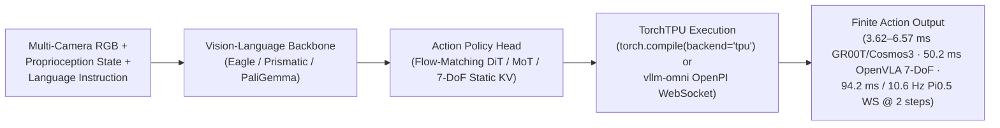

# Robotics & Vision-Language-Action (VLA) Serving on Google Cloud TPUs (TorchTPU)

PyTorch (`torch_tpu`) control-loop and serving benchmarks for Vision-Language-Action (VLA) robotics models on **Google Cloud TPU v7x** and **TPU v5p**. With native `torch.compile(backend="tpu")` on a single TPU v7x TensorCore, **GR00T-N1.7-3B** runs from **`3.62 ms` (`276.2 Hz`, 2 steps)** to **`6.33 ms` (`158.0 Hz`, 4 steps)** and drives **4 dual-camera robots above 50 Hz (`18.65 ms`)** or **8 robots above 20 Hz (`32.78–35.98 ms`)**, **Cosmos3-Edge-Policy-DROID** runs at **`6.57 ms` (`152.1 Hz`)**, and 7.5B **OpenVLA-7B** executes a full compiled **7-DoF autoregressive action loop** in **`50.24 ms` (`19.9 Hz`, `4.56×` faster than eager)** (`11.28 ms` / `88.6 Hz` for a 1-step forward). Meanwhile, **Pi0.5 (`lerobot/pi05_base`)** serves `[50, 32]` action chunks end-to-end over WebSocket on **`vllm-omni 0.33.0rc1`** in **`94.24 ms` (`10.61 Hz`, `530.6 actions/sec`)** at 2 steps and **`130.73 ms` (`7.65 Hz`)** at 4 steps.

---

## Models & Licenses

This repository tracks Vision-Language-Action (VLA) and robotics policy benchmarks on Google Cloud TPUs. Each model's folder contains detailed tables and reproduction commands.

| Model | Params & Precision | Architecture & Control Output | License | Folder |
| :--- | :---: | :--- | :---: | :--- |
| [`nvidia/GR00T-N1.7-3B`](https://huggingface.co/nvidia/GR00T-N1.7-3B) | 3B (`bf16`) | 16-layer Eagle VLM + 4-step Flow-Matching DiT action chunks (`40`-step horizon) | NVIDIA Open Model | [`gr00t-n1.7-3b/`](gr00t-n1.7-3b/README.md) |
| [`nvidia/Cosmos3-Edge-Policy-DROID`](https://huggingface.co/nvidia/Cosmos3-Edge-Policy-DROID) | 537 MoT tensors (`bf16`) | Mixture-of-Transformers 4-step continuous action policy (`16–32` horizon) | NVIDIA Open Model | [`cosmos3-edge-policy/`](cosmos3-edge-policy/README.md) |
| [`openvla/openvla-7b`](https://huggingface.co/openvla/openvla-7b) | 7.54B (`bf16`) | Prismatic VLM + Llama-2 7B predicting 7-DoF discrete actions | MIT | [`openvla-7b/`](openvla-7b/README.md) |
| [`lerobot/pi05_base`](https://huggingface.co/lerobot/pi05_base) | 3B (`bf16` / `fp32`) | PaliGemma-3B VLM + 300M flow-matching action expert (`[50, 32]` chunks) | Apache-2.0 *(PaliGemma: Gemma)* | [`pi0.5/`](pi0.5/README.md) |

---

## Hardware & Software Stack

| Component | Configuration |
| :--- | :--- |
| **TPU v7x** | 1 TensorCore (96 GB HBM) for compiled control loops & `vllm-omni` `Pi0.5` policy serving |
| **TPU v5p** | 1 chip (95 GB HBM) for compiled control loops; 4 chips for `vllm-omni` serving |
| **PyTorch Compilation** | Native `torch.compile(backend="tpu")` on `torch 2.13.0`, `torch_tpu 0.2.0`, `libtpu 0.0.50` |
| **Serving Engines Audited** | `vllm-torchtpu v0.33.0` + `vllm-omni 0.33.0rc1` (`deploy/pi05.yaml`, `deploy/cosmos3_policy_droid.yaml`) & `sglang-torchtpu` (`main`) |

---

## Closed-Loop Control Architecture



---

## Main Results (`finite=True` Verified)

All latency and frequency figures below were measured on **1 single TPU core / chip**.

### 1. Single-Core VLA Control Latency & Throughput

| Model | Workload & Batch | TPU v7x (1 core) | TPU v5p (1 chip) | Speedup vs. Eager & Chip Scaling | Control SLA / Throughput |
| :--- | :--- | :---: | :---: | :--- | :---: |
| **GR00T-N1.7-3B** | `1-cam, B=1` (4-step DiT, compiled) | **6.33 ms** (`p95 6.38 ms`, **158.0 Hz**) | 8.42 ms (`p95 8.46 ms`, 118.8 Hz) | **10.3×** (v7x) / **11.4×** (v5p) vs. eager; **1.33×** v7x vs. v5p | **Pass 50 Hz** |
| **GR00T-N1.7-3B** | `2-cam, B=1` (4-step DiT, compiled) | **6.41 ms** (`p95 6.46 ms`, **156.0 Hz**) | 9.00 ms (`p95 9.18 ms`, 111.1 Hz) | **10.1×** vs. eager on v7x; **1.40×** v7x vs. v5p | **Pass 50 Hz** |
| **GR00T-N1.7-3B** | `4-cam, B=1` (4-step DiT, compiled) | **8.15 ms** (`p95 8.22 ms`, **122.7 Hz**) | 9.82 ms (`p95 9.90 ms`, 101.8 Hz) | **6.2×** vs. eager on v7x; **1.20×** v7x vs. v5p | **Pass 50 Hz** |
| **Cosmos3-Edge-Policy** | `ctx=512, act=16, B=1` (compiled) | **6.57 ms** (`p95 6.60 ms`, **152.1 Hz**) | 9.40 ms (`p95 9.45 ms`, 106.4 Hz) | **26.0×** (v7x) / **38.7×** (v5p) vs. eager; **1.43×** v7x vs. v5p | **Pass 50 Hz** |
| **Cosmos3-Edge-Policy** | `ctx=512, act=16, B=4` (compiled) | **14.91 ms** (**67.1 Hz**, **268.3 chunks/s**) | 15.12 ms (66.2 Hz, 264.6 chunks/s) | **9.6×** (v7x) / **24.4×** (v5p) vs. eager | **Pass 50 Hz (4 robots)** |
| **Cosmos3-Edge-Policy** | `ctx=1024, act=32, B=1` (compiled) | **7.71 ms** (`p95 7.81 ms`, **129.7 Hz**) | 11.15 ms (`p95 11.27 ms`, 89.7 Hz) | **15.5×** vs. eager on v7x; **1.45×** v7x vs. v5p | **Pass 50 Hz** |
| **OpenVLA-7B** (7.54B) | **`full 7-DoF loop, B=1` (compiled static KV)** | **50.24 ms** (`p95 50.55 ms`, **19.9 Hz**) | — | **4.56×** faster vs. eager 7-token generate (`228.9 ms`) and **7.43×** vs. eager `predict_action` (`373.1 ms`) | `19.9` full 7-DoF/s (`40.2`/s at `B=4`) |
| **OpenVLA-7B** (7.54B) | `1-step fwd` (compiled) | **11.28 ms** (`p95 13.21 ms`, **88.6 Hz**) | **19.37 ms** (`p95 19.42 ms`, **51.6 Hz**) | **1.72×** faster on v7x vs. v5p | **Pass 50 Hz** |
| **Pi0.5** (`pi05_base`) | **`vllm-omni` WS (`[50, 32]`, 2 steps, `bf16` compiled)** | **94.24 ms** (`p95 103.02 ms`, **10.61 Hz**) | *See `pi0.5/`* | **2.29×–2.39×** faster than 10-step WS (`~16.4 ms/step` + `~61 ms` fixed VLM/WS overhead) | **530.6 actions/sec** |
| **Pi0.5** (`pi05_base`) | **`vllm-omni` WS (`[50, 32]`, 4 steps, `bf16` compiled)** | **130.73 ms** (`p95 135.46 ms`, **7.65 Hz**) | *See `pi0.5/`* | **1.65×–1.72×** faster than 10-step WS (`action_finite=True`) | **382.5 actions/sec** |
| **Pi0.5** (`pi05_base`) | `vllm-omni` WS (`[50, 32]`, 10 steps, `bf16` compiled) | **215.66 ms** (`p95 226.38 ms`, **4.64 Hz**) | *Boots in 36 s* | **1.12×** faster than `bf16` eager (`240.8 ms`) | **231.8 actions/sec** |

### 2. Multi-Robot Fleet Batch Scaling on 1 TPU v7x Core (`GR00T-N1.7-3B`, 4 Steps, Compiled `bf16`)

| Camera Setup | `B=1` Robot | `B=2` Robots | `B=4` Robots | `B=8` Robots | `B=16` Robots |
| :--- | :---: | :---: | :---: | :---: | :---: |
| **1-Cam** (`320` tok) | **6.33 ms** (`158.0 Hz`) | **8.27 ms** (`120.9 Hz`, `9,674` act/s) | **16.67 ms** (**`60.0 Hz`**, **Pass 50 Hz**) | **32.78 ms** (**`30.5 Hz`**, **Pass 20 Hz**) | 64.50 ms (`15.5 Hz`, `9,923` act/s) |
| **2-Cam** (`576` tok) | **6.41 ms** (`156.0 Hz`) | **10.37 ms** (`96.4 Hz`, `7,715` act/s) | **18.65 ms** (**`53.6 Hz`**, **Pass 50 Hz**) | **35.98 ms** (**`27.8 Hz`**, **Pass 20 Hz**) | — |
| **4-Cam** (`1088` tok) | **8.15 ms** (`122.7 Hz`) | **13.34 ms** (`75.0 Hz`, **Pass 50 Hz**) | **21.93 ms** (**`45.6 Hz`**, **Pass 20 Hz**) | — | — |

*(Step-count sweep at 1-cam `B=1`: `2` steps **`3.62 ms` (`276.2 Hz`)**, `4` steps **`6.33 ms` (`158.0 Hz`)**, `8` steps **`12.28 ms` (`81.4 Hz`)**, `16` steps **`22.97 ms` (`43.5 Hz`)**. Compiled `OpenVLA-7B` 7-DoF fleet scaling: `B=1` `50.24 ms` (`19.9` actions/s), `B=2` `59.98 ms` (`33.3` actions/s), `B=4` `99.60 ms` (`40.2` actions/s).)*

---

## Key Engineering Takeaways

1. **Static-KV compilation accelerates full 7-DoF autoregressive VLAs by `4.56×–7.43×`:** Compiling `OpenVLA-7B`'s vision encoder, projector, prefill, and 6 static-KV decode steps into a single XLA graph cuts full 7-DoF control latency from `228.9–373.1 ms` eager down to **`50.24 ms` (`p95 50.55 ms`, `19.9 Hz`)** on 1 TPU v7x core.
2. **A single TPU v7x core drives 4 dual-camera robots above 50 Hz or 8 robots above 20 Hz:** With `torch._dynamo.config.recompile_limit = 64` (preventing eager fallback across multi-camera shapes), `GR00T-N1.7-3B` holds `<20 ms` p95 up to `B=4` for both 1-camera (`16.67 ms`) and 2-camera (`18.65 ms`) fleets, and hits `9,923` actions/sec at `B=16`.
3. **`vllm-omni 0.33.0rc1` VLA server readiness:** `lerobot/pi05_base` (`deploy/pi05.yaml`) serves verified `[50, 32]` action chunks over OpenPI WebSocket from `94.2 ms` (2 steps, `530.6` actions/s) to `215.7 ms` (10 steps), with exact observation schemas and `HF_TOKEN` requirements documented in [`pi0.5/`](pi0.5/README.md) and [`APPENDIX.md`](APPENDIX.md).

---

## How to Reproduce

```bash
# 1) Benchmark OpenVLA-7B (eager + torch.compile(backend="tpu"))
pip install --no-deps timm==0.9.16
python3 scripts/benchmark_robotics_vla.py \
  --model openvla --model-path /path/to/openvla/openvla-7b --iters 12

# 2) Boot Pi0.5 server on vLLM-Omni 0.33.0rc1
export HF_TOKEN=<your_hf_token>
vllm serve /path/to/lerobot/pi05_base \
  --omni \
  --deploy-config $(python3 -c 'import vllm_omni, os; print(os.path.join(os.path.dirname(vllm_omni.__file__), "deploy/pi05.yaml"))') \
  --served-model-name lerobot/pi05_base --host 0.0.0.0 --port 8000 --trust-remote-code
```

---

## Deep Dives, Logs & Raw Results

- **Model Guides:** [`gr00t-n1.7-3b/`](gr00t-n1.7-3b/README.md) · [`cosmos3-edge-policy/`](cosmos3-edge-policy/README.md) · [`openvla-7b/`](openvla-7b/README.md) · [`pi0.5/`](pi0.5/README.md)
- **Ablations, Stability Fixes & Server Audits:** [`APPENDIX.md`](APPENDIX.md)
- **Engineering Log:** [`WORKING_LOG.md`](WORKING_LOG.md)
- **Verified JSON Metrics:** [`results/robotics_vla_summary.json`](results/robotics_vla_summary.json) · [`results/v7x_openvla_groot_scaling.json`](results/v7x_openvla_groot_scaling.json)
